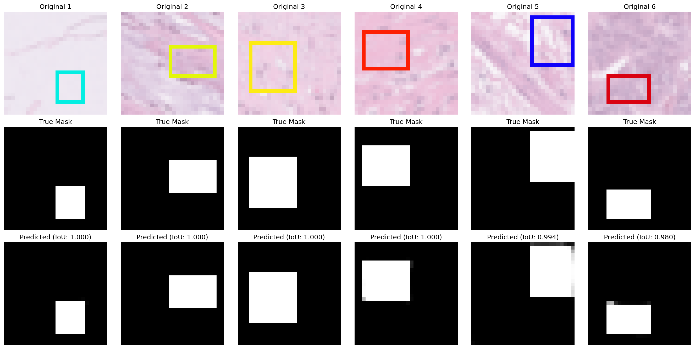
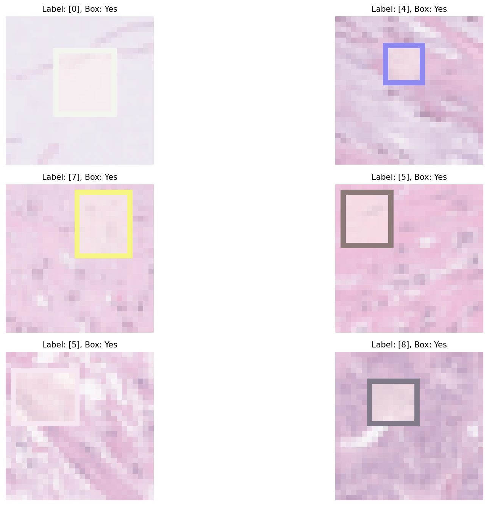

# Medical Imaging with Deep Learning

PyTorch models for histopathology images. The project covers tissue-type classification and pixel-level segmentation on PathMNIST, a collection of 28×28 colon pathology patches. Real clinical systems run far larger networks on far larger images, but the same building blocks drive them: convolutional feature extraction and encoder-decoder segmentation with skip connections. Built as coursework for CPH 100A.

## Results

| Task | Model | Params | Metric | Target |
|---|---|---|---|---|
| 9-class tissue classification | CNN (5 epochs) | 94K | **94.9%** validation accuracy | > 90% |
| Box segmentation | Tiny U-Net (3 epochs) | 118K | **0.999** validation IoU | > 0.97 |

Validation sets: 10,004 images for each task. Training sets: 89,996 images for each task.



## Part 1: Tissue classification

The task is to classify each patch into one of 9 tissue types, such as adipose, mucus, stroma and colorectal adenocarcinoma. I built three models of increasing capacity in `classification_models.py` to show what convolution adds:

- **Linear:** logistic regression on flattened pixels, as a baseline.
- **MLP:** two hidden layers (256 → 128) on flattened pixels.
- **CNN:** two conv blocks (32 then 64 channels), each with two 3×3 convolutions plus BatchNorm, ReLU and max pooling, followed by a linear classifier.

The CNN reached 94.9% validation accuracy. Unlike the flattened-pixel models, it keeps the spatial structure of the image. Training uses Adam with cross-entropy loss. The training set gets random horizontal and vertical flips, which are valid for pathology tiles because tissue has no "up". The validation set stays fixed so accuracy is stable.

## Part 2: Segmentation

Each PathMNIST image gets a randomly colored box drawn on it (`synthetic_data.py`), and the model must predict the pixel mask of that box region.



Models in `segmentation_models.py`:
- **Linear and MLP:** predict all 784 mask pixels from flattened input.
- **CNN encoder-decoder:** downsamples to 7×7 and upsamples back, with no skip connections.
- **Tiny U-Net:** a 3-level encoder (16 → 32 → 64 channels) with skip connections that concatenate encoder features into the decoder, so fine boundary detail is recovered.

The loss is an equal-weighted combination of BCE and Dice. Dice directly optimizes overlap, which keeps the model from ignoring the small foreground region.

## Running it

```bash
pip install -r requirements.txt

# Classification (0 = train on the full epoch instead of the 100-step quick mode)
python classification_main.py --model_name cnn --num_epochs 5 --max_steps_per_epoch 0

# Segmentation
python segmentation_main.py --model_name unet --num_epochs 3 --max_steps_per_epoch 0
```

Model options: `linear`, `mlp` and `cnn` for classification, plus `unet` for segmentation. PathMNIST downloads automatically through the `medmnist` package into `./data`. The results above came from a CPU run.

## Limitations

- At 28×28, the images are far smaller than real whole-slide images, which run to gigapixels. Scaling up requires tiling, more depth, and a lot more compute.
- The segmentation task uses synthetic boxes, so it tests whether the architecture can localize regions, not whether it can segment real anatomy. A near-perfect IoU here does not carry over to tumor or gland segmentation.
